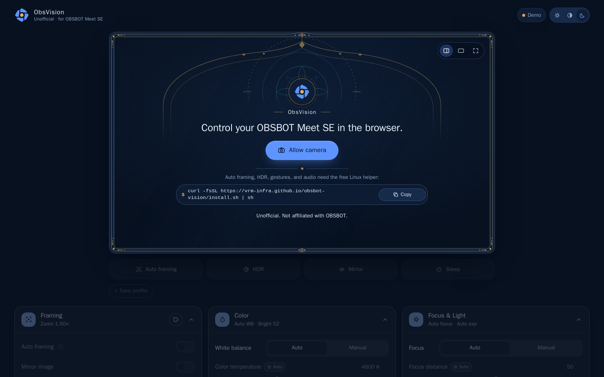
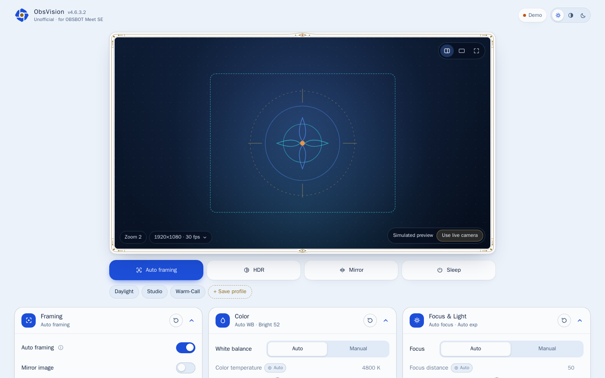
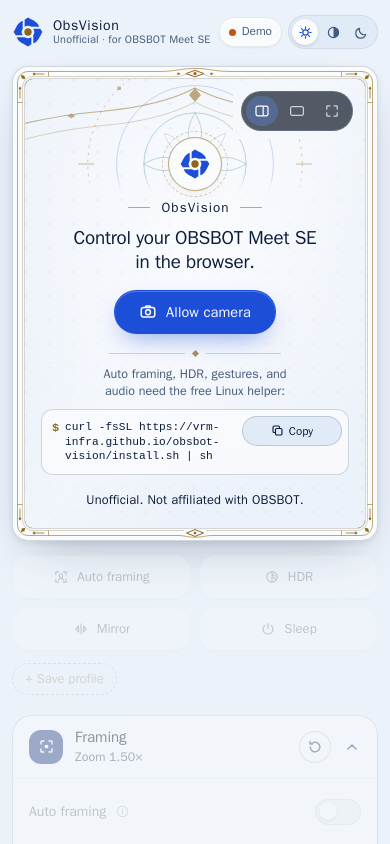

<!-- readme: kind=app -->
# ObsVision

ObsVision is a web page that controls the OBSBOT Meet SE webcam on Linux.
It is an independent, unofficial project, not affiliated with, endorsed by or supported by OBSBOT.
OBSBOT and Meet SE are trademarks of their owners.



## Status

Active.
Version 0.1.1, tested on Chrome with a Meet SE on 2026-11-24.

## Features

- Browser mode needs no install.
- It shows the controls Chrome reports for your camera: zoom, pan, tilt, focus, exposure, white balance, brightness, contrast, saturation and sharpness.
- Helper mode adds auto framing, HDR, gestures, microphone settings, sleep, the LED and saved profiles.
- The helper is a small program on your computer.
- The page finds the helper on `http://127.0.0.1:8737`.
- Light and dark themes, and a layout that fits a phone-width window.





## Quick start

Open <https://vrm-infra.github.io/obsbot-vision/> in Chrome and allow the camera.
For helper mode, install the helper on Linux (x86_64 or aarch64, with systemd).
No sudo is needed.

```bash
curl -fsSL https://vrm-infra.github.io/obsbot-vision/install.sh | sh
```

The script downloads the binary from the latest release of this repository.
It checks the SHA-256 against `SHA256SUMS` from the same release.
It installs `~/.local/bin/obsbot` and starts it at login as a systemd user service.

## Layout

```text
index.html    the ObsVision page
install.sh    the helper installer
docs/         images and the download list
```

## Security notes

- The page never sends your video or settings to any server.
- It talks only to your browser and to the helper on your own computer.

## Limits

- Chrome and Edge ask once for camera access, and once for permission to move the camera (pan, tilt, zoom).
- Chrome 142 and newer asks before a public page may call your own computer.
- Allow it when Chrome asks.
- Only Chrome is tested.
- A browser that blocks a public page from calling `127.0.0.1` cannot use helper mode, but browser mode still works.

## Docs

- [docs/downloads.md](docs/downloads.md): release files, the systemd unit and removal.

## License

MIT.
See `LICENSE`.
